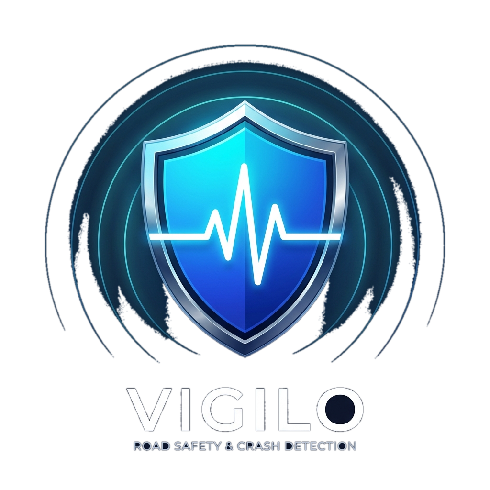
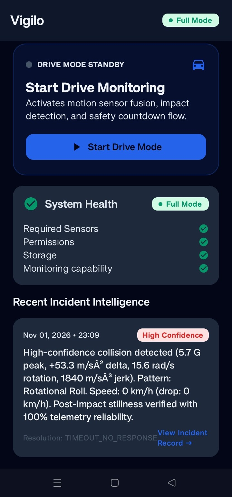
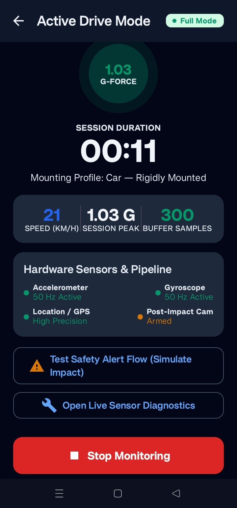
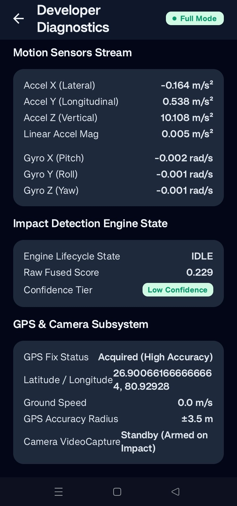
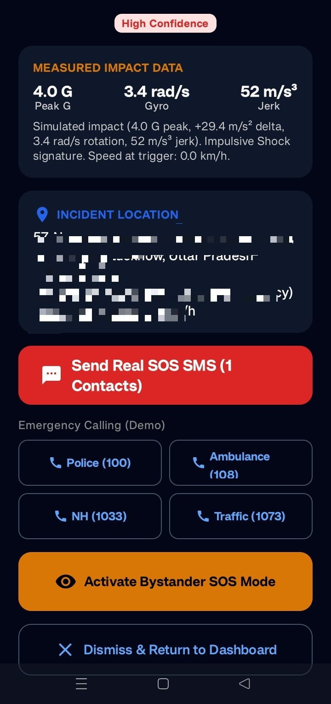
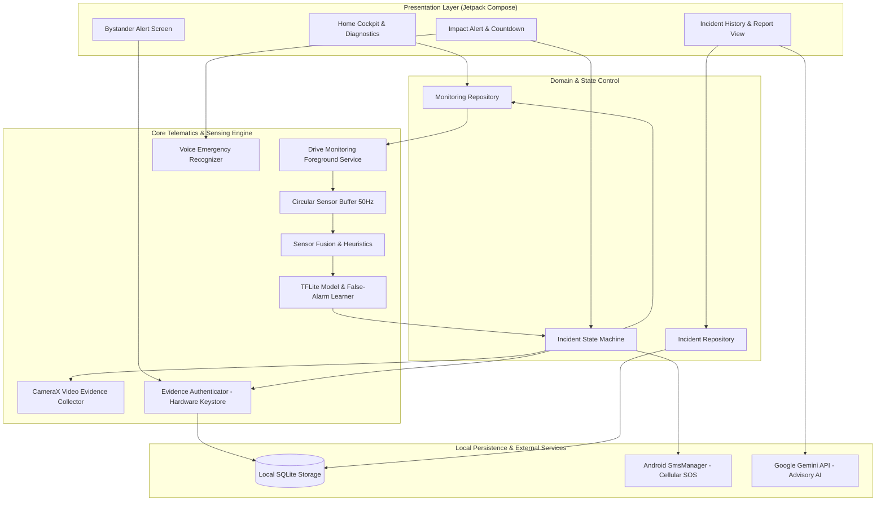

<div align="center">

  

  # Vigilo

  ### Intelligent Road Incident Response & Evidence Preservation Platform

  <p align="center">
    <a href="https://vigilo-showcase.vercel.app/">
      
    </a>
    <a href="https://vigilo-showcase.vercel.app/enterprise">
      
    </a>
    <a href="https://www.linkedin.com/in/bhvya-vaish">
      
    </a>
    <a href="PROJECT_STATUS.md">
      
    </a>
  </p>

  <p align="center">
    
    
    
    
    
    
  </p>

</div>

---

> [!IMPORTANT]
> **Official Live Deployment & Documentation Hub**  
> * 🌐 **Official Live Showcase:** [https://vigilo-showcase.vercel.app/](https://vigilo-showcase.vercel.app/)  
> * 💼 **Enterprise & Fleet Solutions:** [https://vigilo-showcase.vercel.app/enterprise](https://vigilo-showcase.vercel.app/enterprise)  
> * 👨‍💻 **Lead Architect & Developer:** [Bhvya Vaish](https://www.linkedin.com/in/bhvya-vaish)  
> * 📋 **Capability Verification Matrix:** [`PROJECT_STATUS.md`](PROJECT_STATUS.md)  
> * 📐 **Deep Architecture Documentation:** [`docs/architecture.md`](docs/architecture.md)

---

## Executive Overview

**Vigilo** (from the Latin verb *vigilō*, meaning *"I remain alert"*) is an intelligent Android mobile telematics and road-incident response platform that acts as an autonomous first responder when motorists cannot help themselves.

Operating with an **offline-first, zero-connectivity architecture**, Vigilo continuously evaluates triaxial inertial measurements and GPS kinematics at 50Hz. Upon detecting potential collision shockwaves, it initiates an emergency countdown with hands-free voice command cancellation, autonomously transmits location-precise distress SMS alerts to emergency contacts, signals nearby bystanders with an optical flashlight strobe, and cryptographically signs forensic telemetry and video evidence using the hardware-backed Android Keystore.

```
┌─────────────────────────────────────────────────────────────────────────────┐
│                       VIGILO CORE OPERATIONAL LOOP                          │
│                                                                             │
│   DETECT  ──────►  ALERT  ──────►  PRESERVE  ──────►  DOCUMENT  ──────► EXPORT │
│ (50Hz IMU)    (10s Count)     (Keystore)     (Deterministic)     (Claims)   │
└─────────────────────────────────────────────────────────────────────────────┘
```

---

## Quick Navigation

* 🌐 [Official Live Deployment](#official-live-deployment)
* 💡 [The Problem & Proposed Solution](#the-problem)
* 🛡️ [Evidence Preservation & Tamper-Proof Vault](#evidence-preservation--tamper-proof-vault)
* ⚡ [Core Features Matrix](#core-features)
* 🔄 [How Vigilo Works (User Journey)](#how-vigilo-works)
* 📸 [Application Screenshots & Interface](#application-screenshots)
* 🏢 [Enterprise, Fleet & Insurance Solutions](#enterprise--fleet-solutions)
* 🏛️ [Systems Architecture](#technical-architecture)
* 🛠️ [Technology Stack](#technology-stack)
* 🧠 [Key Engineering Decisions](#engineering-challenges-and-decisions)
* 🧪 [Testing & Validation Evidence](#testing-and-validation)
* 🔒 [Privacy & Evidence Integrity](#privacy-and-evidence-integrity)
* 🗺️ [Limitations & Future Improvements](#limitations-and-future-improvements)
* ⚖️ [Intellectual Property Notice](#intellectual-property-and-source-code-notice)
* 👨‍💻 [About the Developer](#about-the-developer)

---

## Official Live Deployment

The official Vigilo web portal is hosted on Vercel and fully integrated with this GitHub repository:

| Portal | URL | Purpose |
| :--- | :--- | :--- |
| **Product Showcase** | [https://vigilo-showcase.vercel.app/](https://vigilo-showcase.vercel.app/) | Interactive platform overview, detection loop, evidence vault, and screenshots. |
| **Enterprise & Fleet** | [https://vigilo-showcase.vercel.app/enterprise](https://vigilo-showcase.vercel.app/enterprise) | Commercial fleet telematics, insurance acceleration, and white-label licensing. |
| **Robots Directives** | [https://vigilo-showcase.vercel.app/robots.txt](https://vigilo-showcase.vercel.app/robots.txt) | Search engine crawler rules and sitemap declaration. |
| **XML Sitemap** | [https://vigilo-showcase.vercel.app/sitemap.xml](https://vigilo-showcase.vercel.app/sitemap.xml) | Machine-readable indexing endpoints with Google Image tags. |

---

## The Problem

Every year, millions of road traffic collisions occur globally. In a critical portion of fatal or debilitating incidents, casualties occur not because survival was physically impossible, but because **emergency response and discovery arrived too late**.

In everyday civilian motoring, three compounding challenges recur:
1. **The Acute Agency Gap:** When a high-speed impact or rollover occurs, drivers frequently suffer concussions, physical trauma, or entrapment. In shock or unconsciousness, victims cannot locate, unlock, or operate a mobile device to dial for assistance.
2. **The Telematics Hardware Divide:** While premium connected vehicles feature integrated eCall boxes or proprietary telematics, older economy passenger cars, budget commercial vans, and virtually all two-wheelers (motorcycles and scooters) lack automated crash detection hardware entirely.
3. **Post-Crash Forensic Vacuum:** Following an accident, victims and insurance investigators face evidentiary disputes regarding speed, pre-impact braking, points of impact, and exact chronological timelines. Conventional dashcams often fail to record post-impact aftermath or lack cryptographic mechanisms to prove footage was untampered.

---

## The Proposed Solution

Vigilo transforms an ordinary consumer Android smartphone into a self-contained, intelligent emergency telematics terminal without requiring aftermarket vehicle wiring, CAN-bus dongles, or subscriptions:

1. **Passive High-Frequency Sentry:** Continuously processes triaxial accelerometer, gyroscope, and GPS velocity drops in a lightweight background foreground service.
2. **Fail-Safe Alert Verification:** Provides a high-contrast 10-second countdown with both touch and hands-free voice command cancellation (*"I'm okay"*) to filter out potholes or dropped phones before any alert leaves the device.
3. **Autonomous Escalation:** If the driver is incapacitated (timer expires with no response), the platform automatically sends SMS alerts with exact coordinates and Google Maps links to designated emergency contacts and activates an optical bystander strobe.
4. **Cryptographic Forensic Vault:** Digitally signs all telemetry vectors and video files using the device's hardware secure enclave (ECDSA with SHA-256), creating verifiable incident evidence.
5. **Deterministic Factual Documentation:** Compiles machine-readable JSON and plain-text incident reports for insurance claims, accompanied by an optional, strictly non-authoritative advisory AI narrative.

*Notice: Vigilo is designed as an emergency intelligence aid. It complements, rather than replaces, official municipal emergency services, and avoids making unauthorized autonomous calls to public emergency switchboards.*

---

## Evidence Preservation & Tamper-Proof Vault

A cornerstone of Vigilo is its **tamper-evident forensic architecture**. Following a road incident, physical evidence is frequently lost, disputes arise between motorists, and insurance claim settlements take months due to lack of verifiable data.

```
┌─────────────────────────────────────────────────────────────────────────────┐
│                     THE 5-STAGE EVIDENCE LIFECYCLE                          │
│                                                                             │
│  [1] MULTI-AXIS TRIGGER  ──►  [2] MULTI-SOURCE RECORDING                    │
│      Shock spike detection         Pre/post impact kinematics, GPS & video  │
│                                                   │                         │
│  [4] OFFLINE SECURE VAULT ◄── [3] HARDWARE DIGITAL SEALING                  │
│      Isolated tamper-evident storage  Android Keystore ECDSA & SHA-256 hash │
│            │                                                                │
│  [5] CLAIMS-READY DOSSIER                                                   │
│      Deterministic JSON & text export for IRDAI insurers & legal defense    │
└─────────────────────────────────────────────────────────────────────────────┘
```

### What Is Preserved in the Vault:
* **Pre- & Post-Impact Kinematics:** Peak deceleration forces (G-force), delta-V, and rotational angular rates at 50Hz.
* **Geospatial Anchoring:** High-precision GPS coordinates, reverse-geocoded street address, bearing, and altitude.
* **Synchronized Visual Evidence:** Post-collision video capture documenting scene conditions and vehicle resting positions.
* **Cryptographic Provenance:** Hardware-backed ECDSA digital signature over canonical telemetry facts and video SHA-256 digest, providing mathematical proof of zero post-incident tampering.

---

## Core Features

| Feature | Operational Purpose | Current Implementation Status | Demonstration Availability |
| :--- | :--- | :--- | :--- |
| **Alert Countdown & Cancellation** | 10s configurable (5–30s) verification window with audible alarms, haptics, and response buttons (*"I'm OK"*, *"False Alarm"*, *"I Need Help"*). | **Completed (Verified in Implementation)** | Available via in-app "Test Safety Alert Flow". |
| **Hands-Free Voice Commands** | Allows trapped or injured drivers to dismiss alerts or request assistance verbally (*"I'm okay"* / *"I need help"*) without touching the phone. | **Completed (Verified in Implementation)** | Available via offline Android speech recognition. |
| **Bystander Alert Mode** | High-contrast amber visual screen with GPS coordinates and a 200ms camera torch optical strobe to attract roadside passers-by at night. | **Completed (Verified in Implementation)** | Available via countdown expiration or manual toggle. |
| **Emergency Contact SMS & Location** | Autonomous background multi-part SMS dispatch with exact GPS coordinates and Google Maps links to up to 5 personal contacts. | **Completed (Verified in Implementation)** | Available on physical devices with active SIM. |
| **Emergency Helpline Calling Grid** | Rapid-access calling grid for official services (Police 100, Ambulance 108, Highway 1033). | **Simulated (By Safety Design)** | In-app simulated call screen with timer; no real dial. |
| **Adaptive False-Alarm Mitigation** | Hybrid 9-dimensional physics engine with on-device machine learning confirmation gate and online threshold adaptation. | **Completed (Verified in Implementation)** | Evaluated continuously during drive monitoring. |
| **Offline-First Telematics Core** | Fully autonomous local operation without cloud dependence; persists incidents, settings, and state to local storage. | **Completed (Verified in Implementation)** | Fully functional in zero-connectivity environments. |
| **Post-Impact Video Evidence** | Hardware-accelerated camera recording capturing post-impact scene footage to secure storage. | **Completed (Verified in Implementation)** | Functional video capture; audio dedicated to voice safety commands. |
| **Hardware Keystore Evidence Vault** | Signs canonical telemetry facts and video SHA-256 digests via Android Hardware Keystore (ECDSA key pair). | **Completed (Verified in Implementation)** | Interactive "Verify All Evidence" UI in Incident Details. |
| **Deterministic Incident Reporting** | Generates exportable plain text and structured JSON incident reports with clipboard copy and Android share sheet. | **Completed (Verified in Implementation)** | Available in Report screen with format toggle. |
| **AI-Assisted Advisory Reporting** | Generates non-authoritative collision advisory summaries and timeline analyses using AI integration. | **Completed (Verified in Implementation)** | Functional with API key; graceful offline fallback. |

*Detailed capability specifications are documented in [`docs/features-and-workflows.md`](docs/features-and-workflows.md).*

---

## How Vigilo Works

The complete end-to-end user journey within the Vigilo application:

```
┌─────────────┐     ┌──────────────┐     ┌─────────────┐     ┌──────────────┐
│ 1. Onboard  │ ──► │ 2. Drive     │ ──► │ 3. Detect   │ ──► │ 4. Alert     │
│ Permissions │     │ Monitoring   │     │ Impact Peak │     │ Countdown    │
└─────────────┘     └──────────────┘     └─────────────┘     └──────┬───────┘
                                                                    │
                    ┌──────────────┐     ┌─────────────┐            │
                    │ 7. Report &  │ ◄── │ 6. Evidence │ ◄──────────┘
                    │ Verification │     │ Preserved   │     (User Response / Timeout)
                    └──────────────┘     └─────────────┘
```

1. **Step 1: First-Time Setup:** The user grants runtime permissions sequentially and configures up to 5 emergency contacts with phone numbers in Settings.
2. **Step 2: Starting Drive Monitoring:** The user opens the cockpit, confirms their phone mounting placement (`Car Mount`, `Two-Wheeler Mount`, or `In-Pocket/Bag`), and taps **"Begin Drive Monitoring"**. A persistent foreground service activates.
3. **Step 3: Active Monitoring:** The phone continuously buffers 50Hz sensor data into a circular ring buffer. The user drives normally; no screen interaction is required.
4. **Step 4: Impact Shock Detection:** If a sudden deceleration spike occurs accompanied by rotational anomaly and post-impact standstill, the fusion engine triggers an alert.
5. **Step 5: The 10-Second Safety Countdown:** The screen transitions to a pulsing red alert. Audible alarms and haptics pulse every second:
   * **Path A (User Safe):** Driver taps *"I'm OK"* or speaks *"I'm okay"*. The alert dismisses safely.
   * **Path B (False Positive):** Driver taps *"False Alarm"*. Monitoring immediately resumes and sensitivity calibrates.
   * **Path C (Distress Confirmed):** Driver taps *"I Need Help"* or speaks *"Help"*. Immediate escalation.
   * **Path D (Incapacitation / Timeout):** If 10 seconds elapse with zero response, Vigilo automatically escalates.
6. **Step 6: Autonomous Escalation & Bystander Alert:** Background SMS alerts containing GPS coordinates and Google Maps links are dispatched to emergency contacts. The screen activates Bystander Mode with a strobing camera flashlight to signal passers-by.
7. **Step 7: Forensic Preservation & Sealing:** Post-impact video recording flushes to disk. A canonical string of telemetry facts is signed by the Android Hardware Keystore ECDSA key pair, binding the video SHA-256 digest to the physical device.
8. **Step 8: Deterministic Report Export:** The driver or investigator reviews the verified timeline, verifies the cryptographic signature, and exports structured plain text or JSON reports.

---

## Application Screenshots

> [!NOTE]
> **Verified Mobile Interface:** Below are actual application screenshots captured from a physical device running the Vigilo Android build, demonstrating the end-to-end incident intelligence, alerting, and evidence verification workflow.

<table width="100%">
  <tr>
    <td width="50%" align="center" valign="top">
      
      <br />
      <b>01. Home Dashboard & Profile Selector</b>
      <p><i>Telematics launcher with profile calibration (Car Mount, Two-Wheeler, In-Pocket/Bag) and recent incident metrics.</i></p>
    </td>
    <td width="50%" align="center" valign="top">
      
      <br />
      <b>02. Active Drive Cockpit</b>
      <p><i>Live 50Hz sensor fusion HUD displaying instantaneous G-force, vehicle GPS speed, and safety alert trigger.</i></p>
    </td>
  </tr>
  <tr>
    <td width="50%" align="center" valign="top">
      
      <br />
      <b>03. Live Sensor Diagnostics</b>
      <p><i>High-frequency diagnostics showing real-time triaxial accelerometer and gyroscope streams and buffer capacity.</i></p>
    </td>
    <td width="50%" align="center" valign="top">
      
      <br />
      <b>04. Impact Alert Countdown</b>
      <p><i>10-second high-contrast alert countdown with Confidence Tier badge, audible sirens, and voice recognition.</i></p>
    </td>
  </tr>
  <tr>
    <td width="50%" align="center" valign="top">
      
      <br />
      <b>05. Emergency Assistance Screen</b>
      <p><i>Accident coordinates, reverse-geocoded location, measured impact dynamics, and simulated emergency calling grid.</i></p>
    </td>
    <td width="50%" align="center" valign="top">
      
      <br />
      <b>06. Bystander SOS Screen</b>
      <p><i>High-visibility amber strobe screen with camera flashlight pulses (200ms) for night-time roadside responders.</i></p>
    </td>
  </tr>
  <tr>
    <td width="50%" align="center" valign="top">
      
      <br />
      <b>07. Incident History Journal</b>
      <p><i>Persistent local log with confidence tier filter chips (All, High, Medium, Low) and incident summary cards.</i></p>
    </td>
    <td width="50%" align="center" valign="top">
      
      <br />
      <b>08. Evidence Vault & Verification</b>
      <p><i>Hardware Keystore ECDSA signature and SHA-256 video hash showing green <b>VERIFIED</b> forensic status.</i></p>
    </td>
  </tr>
  <tr>
    <td width="50%" align="center" valign="top">
      
      <br />
      <b>09. Deterministic Factual Report</b>
      <p><i>Structured incident report with Factual Text vs JSON toggle and non-authoritative advisory AI narrative.</i></p>
    </td>
    <td width="50%" align="center" valign="top">
      
      <br />
      <b>10. Emergency Settings & Contacts</b>
      <p><i>Configurable countdown duration (5–30s), bystander alert preferences, DND override, and up to 5 SOS contacts.</i></p>
    </td>
  </tr>
</table>

---

## Enterprise, Fleet & Insurance Solutions

Vigilo offers dedicated B2B integration paths for commercial logistics, fleet operators, and motor insurers:

* **Commercial Fleet Safety:** Real-time driver risk management, automated incident notifications, and driver exoneration evidence.
* **Insurance Claim Acceleration:** Instant First Notice of Loss (FNOL) dossiers with tamper-proof cryptographic telemetry to accelerate claim approvals.
* **White-Label SDK Integration:** Embed the Vigilo telematics engine and evidence vault into existing enterprise fleet or consumer insurer mobile apps.

*Explore the enterprise portal: [https://vigilo-showcase.vercel.app/enterprise](https://vigilo-showcase.vercel.app/enterprise)*

---

## Technical Architecture

Vigilo is architected with a strict separation of concerns, decoupling UI presentation from telematics collection, background execution, and local persistence:



*For complete diagrams, state machine transitions, and mathematical formulas, see [`docs/architecture.md`](docs/architecture.md).*

---

## Technology Stack

Every technology listed below was verified by direct inspection of the codebase configuration:

### Application Technologies
* **Kotlin (`2.2.10`):** Core language providing expressive, type-safe implementation across all application modules.
* **Jetpack Compose (BOM `2024.09.00`):** Declarative Android UI toolkit used to build the cockpit, pulsing alert cards, diagnostics, and reports.
* **Android SDK (Min SDK `24`, Target SDK `36`):** Modern Android runtime target compatible with devices running Android 7.0 through Android 16.
* **AndroidX Lifecycle & ViewModel (`2.8.7`):** Provides lifecycle-aware reactive `StateFlow` state-holders and coroutine scopes.
* **AndroidX Lifecycle Service (`2.8.7`):** Hosts the continuous background `DriveMonitoringService`.
* **AndroidX Navigation Compose (`2.8.9`):** Manages single-activity declarative navigation graphs and alert overlays.
* **AndroidX CameraX (`1.5.0`):** Orchestrates hardware-accelerated video evidence recording via `VideoCapture`.
* **AndroidX Room (`2.7.0`):** Object-relational mapping for local SQLite database persistence.
* **TensorFlow Lite (`2.16.1`):** Embedded neural network runtime evaluating normalized telemetry vectors for crash classification.
* **Android Hardware Keystore (`AndroidKeyStore`):** Generates EC key pairs in the hardware Trusted Execution Environment to sign evidence via ECDSA (`SHA256withECDSA`).
* **Android SmsManager:** Telephony platform API dispatching multi-part background emergency SMS messages.
* **Android SpeechRecognizer:** Platform speech service executing hands-free voice commands with `EXTRA_PREFER_OFFLINE = true`.
* **Kotlin Coroutines (`1.10.2`):** Asynchronous concurrency primitives managing timers and sensor pipelines.
* **Moshi Kotlin (`1.15.2`):** JSON serialization library generating structured incident report exports and API models.
* **Google Gemini API (`gemini-3.6-flash`):** Advisory collision intelligence service generating non-authoritative incident narratives.

---

## Engineering Challenges and Decisions

Vigilo's development involved resolving genuine technical constraints encountered when converting a consumer smartphone into a telematics device:

### 1. Hybrid Sensor Fusion vs. Black-Box Deep Learning
* **The Problem:** Deep learning models evaluated continuously on 50Hz sensor streams cause severe battery drain and behave unpredictably on novel physical vibrations (e.g., dropping a phone inside a car).
* **Approach Used:** Implemented a deterministic 9-dimensional physics engine calculating gravity-isolated linear acceleration, jerk ($da/dt$), rotational surge, and post-impact standstill, with an embedded TensorFlow Lite model acting as an optional confirmation gate.
* **Rationale:** Maximizes battery efficiency, delivers instant deterministic explainability, and guarantees uninterrupted operation if ML runtimes encounter exceptions.

### 2. Audio Hardware Contention: Voice Commands vs. Video Audio
* **The Problem:** When an impact occurs, Vigilo records post-impact video evidence while simultaneously listening for driver voice commands (*"I'm okay"*). In the Android audio subsystem, binding microphone audio to CameraX VideoCapture causes `SpeechRecognizer` to fail with `ERROR_AUDIO` due to exclusive microphone hardware locking.
* **Approach Used:** Audio capture was deliberately disabled in `VideoEvidenceCollector.kt`, producing silent MP4 video clips and dedicating 100% of the microphone input to real-time speech recognition during the 10-second alert window.
* **Rationale:** Life safety takes absolute precedence over media completeness: a trapped driver's verbal false-alarm dismissal or distress call is drastically more important than recording ambient engine audio.

### 3. Hardware Keystore Digital Signatures vs. Cloud Attestation
* **The Problem:** Vehicular telemetry is frequently contested in legal liability and insurance proceedings. Storing telemetry in plain SQLite files allows post-event tampering. Conversely, transmitting data to a cloud attestation server is impossible if the crash occurs in a cellular dead zone.
* **Approach Used:** Vigilo generates an asymmetric EC key pair in the **Android Hardware-Backed Keystore** (TEE / StrongBox). It compiles key incident telemetry into a canonical string, digests the video file using chunked SHA-256 (8KB buffers), and signs both with `SHA256withECDSA`.
* **Rationale:** Provides 100% offline, tamper-evident cryptographic preservation at the point of impact.

---

## Testing and Validation

Vigilo has been evaluated using automated unit testing suites, local test runners, and physical hardware validation:

| Test Area | Test Method | Observed Result | Validation Status |
| :--- | :--- | :--- | :--- |
| **Circular Sensor Buffer FIFO** | JVM Unit Test | Buffer capped at 50; oldest samples evicted properly; peak acceleration and gyro verified. | **Verified Passing** |
| **Normal Driving Baseline Filtering** | JVM Unit Test | 1G gravity vectors and minor steering angular rates return normal status. | **Verified Passing** |
| **Multi-Stage Impact Detection** | JVM Unit Test | 4.5G shock triggers Suspected stage, followed by post-impact stillness triggering Confirmed stage with High confidence. | **Verified Passing** |
| **Permission Management & Resolution** | JVM Unit Test | Resolves missing runtime permissions and builds sequential request flows. | **Verified Passing** |
| **Location Telemetry Tracker** | JVM Unit Test | Tracks GPS coordinate updates and flags degraded states when fix is lost. | **Verified Passing** |
| **Hardware Keystore ECDSA Integrity** | Physical Device Execution | Generates EC key pair in `AndroidKeyStore`, signs canonical telemetry, and verifies successfully. | **Verified on Hardware** |
| **Automated SOS SMS Dispatch** | Physical Device SIM Execution | Dispatches multi-part background SMS with GPS coordinates and Google Maps links to real mobile numbers. | **Verified on Hardware** |
| **Automotive Barrier Crash Testing** | Physical Crash Facility | High-speed vehicle collision with physical impact barriers. | **Not Conducted (Simulated Telemetry Only)** |

*For complete test execution logs and manual verification protocols, see [`docs/testing-and-validation.md`](docs/testing-and-validation.md).*

---

## Privacy and Evidence Integrity

Vigilo is designed as an **offline-first, privacy-respecting telematics terminal**:

1. **Zero Passive Surveillance:** Sensor data is evaluated in a volatile circular RAM buffer. Routine driving telemetry is never saved to disk, and background video is never recorded during normal drives.
2. **Local-First Processing:** Core detection, alert countdowns, speech recognition, and cryptographic signing execute 100% on the local phone without sending data to external servers.
3. **No Centralized Contact Tracking:** Emergency contact phone numbers remain strictly local in the device's secure app storage and are accessed exclusively to populate outgoing SMS recipients.
4. **Cryptographic Scope & Integrity Boundaries:**
   * **What SHA-256 and ECDSA Prove:** Mathematically guarantees that the stored telemetry numbers, coordinates, and video bytes have not been edited or corrupted since being signed by the device's hardware enclave.
   * **What Cryptography Does Not Prove:** A digital hash does not independently prove external physical truth, whether the vehicle was at fault, or sensor calibration accuracy.

---

## Intellectual Property and Source-Code Notice

> **The original Vigilo source-code repository is maintained privately to protect the project's implementation and intellectual property during ongoing development and evaluation. This public repository is intended to document the project's goals, architecture, verified capabilities, and demonstration resources. It does not distribute the application source code or compiled APK.**

*For detailed rights reservations, collaboration guidelines, and licensing inquiries, see [`IP_AND_SOURCE_CODE_POLICY.md`](IP_AND_SOURCE_CODE_POLICY.md).*

---

## About the Developer

Vigilo was designed, engineered, and prototyped by **Bhvya Vaish**, an Android telematics and mobile systems developer.

* 🌐 **Portfolio:** [https://bhvyavaish.vercel.app/](https://bhvyavaish.vercel.app/)
* 💼 **LinkedIn:** [https://www.linkedin.com/in/bhvya-vaish/](https://www.linkedin.com/in/bhvya-vaish/)
* 🐙 **GitHub:** [https://github.com/bhvyavaish/](https://github.com/bhvyavaish/)
* 📧 **Contact:** Available via LinkedIn or Portfolio portal

---

<div align="center">
  <sub>© 2026 Vigilo · Developed by <a href="https://www.linkedin.com/in/bhvya-vaish/">Bhvya Vaish</a> · All Rights Reserved</sub>
</div>
