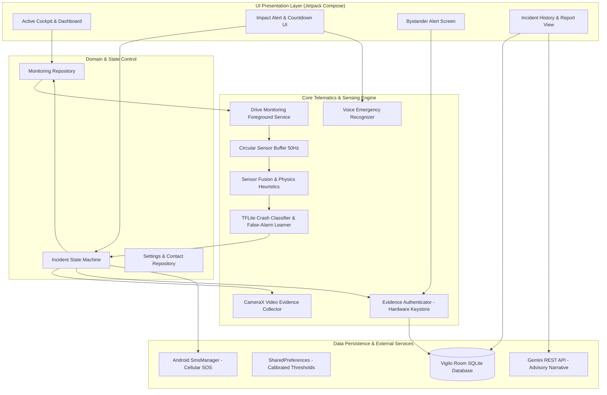
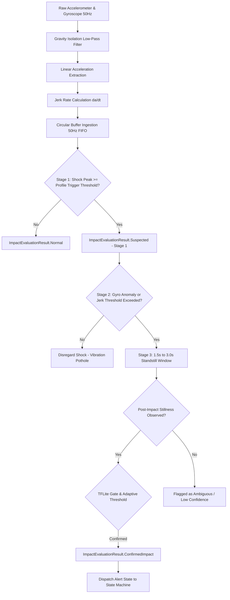
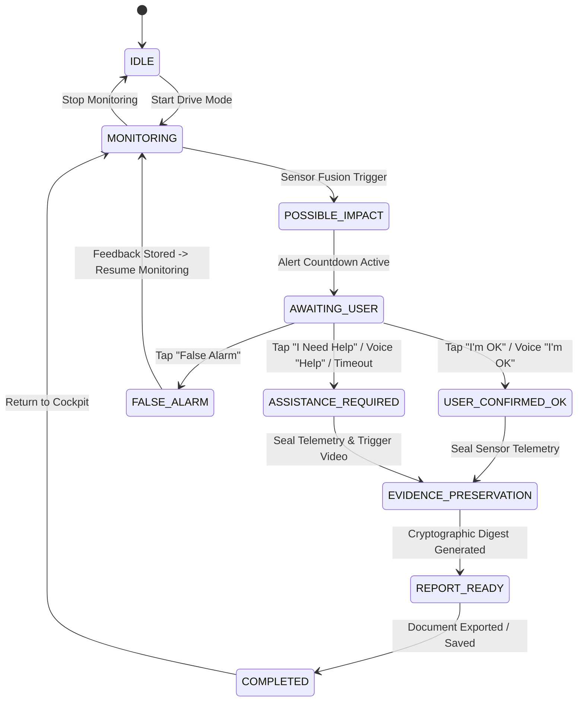
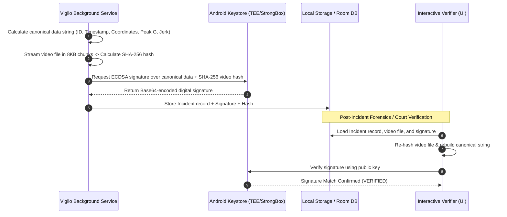

# Systems Architecture & Telematics Design

## 1. High-Level Architecture Overview

Vigilo is structured as a **local-first, reactive Android application** with clean separation between UI presentation, domain business rules, hardware telematics collection, and local persistence.

The architecture emphasizes:
1. **Zero-Latency Sensing:** Continuous 50Hz sensor collection isolated in a dedicated background foreground service.
2. **Determinism:** State machine-driven incident progression preventing race conditions or ambiguous states.
3. **Forensic Integrity:** Hardware-backed cryptographic signing of evidence at the point of capture.
4. **Advisory AI Isolation:** Cloud AI services exist strictly as non-authoritative narrative layers that can never mutate raw telemetry.

---

## 2. Multi-Stage Sensor Fusion Pipeline

Smartphone sensors experience high ambient noise from engine harmonics, road texture, chassis flexing, and sudden maneuvers. To prevent false triggers while catching genuine impacts, Vigilo implements a multi-stage fusion pipeline:

### Sensor Fusion Mathematics

1. **Gravity Low-Pass Filter:**
   $$\mathbf{g}_t = \alpha \mathbf{g}_{t-1} + (1 - \alpha) \mathbf{a}_{raw}, \quad \text{where } \alpha = 0.8$$
2. **Linear Acceleration:**
   $$\mathbf{a}_{linear} = \mathbf{a}_{raw} - \mathbf{g}_t$$
3. **Jerk ($da/dt$):**
   $$J_t = \frac{|\mathbf{a}_{linear, t}| - |\mathbf{a}_{linear, t-1}|}{\Delta t}$$
4. **Post-Impact Stillness Verification:**
   Evaluates linear acceleration variance ($\sigma^2$) across a 1.5s–3.0s rolling post-impact window to differentiate catastrophic stops from brief pothole impacts where driving immediately continues.

---

## 3. Incident Lifecycle State Machine

Incident progression is managed by a deterministic finite state machine (`IncidentStateMachine.kt`), strictly enforcing valid transitions to prevent state corruption:

---

## 4. Cryptographic Evidence Integrity Flow

Vigilo preserves forensic integrity by creating a tamper-evident cryptographic seal around post-impact telemetry:

---

## 5. Background Execution & Resource Management

Operating continuous 50Hz sensor collection in modern Android environments requires compliance with aggressive platform power-management rules:

* **Foreground Service Architecture:** `DriveMonitoringService` runs as an Android `LifecycleService`, declaring foreground service types `location` and `camera` (`FOREGROUND_SERVICE_LOCATION | FOREGROUND_SERVICE_CAMERA`) to comply with Android 14+ requirements.
* **Persistent Notification:** Surfaces ongoing monitoring status, mounting profile, and immediate emergency controls in the notification drawer.
* **Partial WakeLock Management:** Utilizes a power wake lock during active drives to prevent the CPU from entering deep sleep states (Doze mode) while vehicle telemetry is being monitored.
* **Graceful Degradation:** If camera permissions or GPS fixes are lost during driving, the system raises internal degraded-state flags (`degradedStateFlags`) rather than crashing, continuing core IMU collision monitoring uninhibited.
